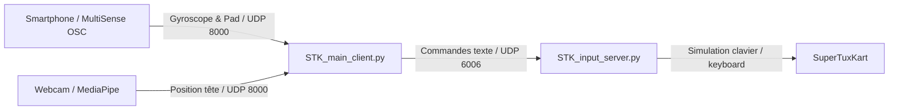
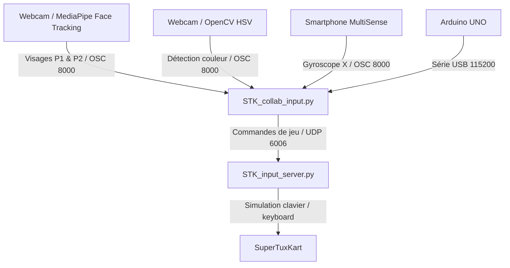

# Contrôleur SuperTuxKart — MCSI

Système de contrôle multimodal pour SuperTuxKart développé dans le cadre du projet MCSI (Master SIIA). Le système remplace les commandes clavier traditionnelles par de la vision par ordinateur (webcam), des capteurs inertiels (smartphone via OSC) et des capteurs physiques embarqués (Arduino).

Le projet propose deux configurations :
- **SetUp_Collab** : version coopérative (2 joueurs en mode principal, mode solo réservé aux tests individuels), combinant suivi facial 3D, détection d'objets colorés pour le tir d'items, secousse du smartphone et capteurs musculaires/vibrations via Arduino.
- **SetUp_Performance** : version individuelle basée sur smartphone (pad tactile / accéléromètre) et suivi facial.

---

## 1. Résumé (Summary)

Le projet permet de piloter un kart sans utiliser le clavier physique :

- **Direction** : calculée à partir de l'angle d'inclinaison de la tête ou de la position horizontale X du visage (Joueur 1 en mode Duo).
- **Accélération / Freinage** : calculée à partir de la distance Z du visage par rapport à la webcam (Joueur 2 en mode Duo). Se rapprocher accélère, reculer freine.
- **Objets (Fire)** : détection d'un carton ou d'un objet coloré (espace HSV) présenté devant la caméra.
- **Secours (Rescue)** : secousse rapide du smartphone via le gyroscope (flux OSC).
- **Dérapage (Drift)** : capteur musculaire EMG sur Arduino (seuil de contraction).
- **Nitro** : capteur de vibration / choc sur Arduino.

---

## 2. Structure du Répertoire

```text
MCSI_STK_Controller/
├── SetUp_Collab/
│   ├── classes/
│   │   ├── actionDetector.py        # Détection de secousses, taps et modulation PWM
│   │   ├── colorDetector.py         # Détection d'objets colorés en HSV
│   │   ├── config.py                # Constantes, seuils et liaisons OSC
│   │   ├── KartState.py             # Machine à états du kart
│   │   └── sensorStates.py          # Buffers thread-safe des capteurs
│   ├── main/
│   │   ├── Sensors/
│   │   │   ├── test_muscle.cpp      # Lecture EMG pour Arduino
│   │   │   ├── test_muscle.h
│   │   │   ├── test_vibration.cpp   # Lecture capteur de vibration
│   │   │   └── test_vibration.h
│   │   └── main.ino                 # Firmware Arduino principal (Série 115200)
│   ├── blaze_face_short_range.tflite # Modèle MediaPipe de détection faciale
│   ├── face_tracking.py             # Capture vidéo, MediaPipe et flux OSC
│   ├── STK_collab_input.py          # Client principal (fusion capteurs et logique de jeu)
│   ├── STK_input_server.py          # Serveur UDP d'injection des touches clavier
│   └── STK_Sender.py                # Wrapper socket UDP
├── SetUp_Performance/
│   ├── classes/
│   │   ├── ActionDetector.py
│   │   ├── Calibration.py
│   │   ├── KartState.py
│   │   └── SensorState.py
│   ├── blaze_face_short_range.tflite
│   ├── face_tracking.py
│   ├── STK_input_server.py
│   └── STK_main_client.py
└── requirements.txt                 # Dépendances Python
```

---

## 3. SetUp_Performance

Configuration axée sur le contrôle individuel par smartphone (application MultiSense OSC envoyant l'inclinaison ou les coordonnées du pad) et suivi de la position de la tête par webcam.

### Flux de données



- `face_tracking.py` transmet la position de la tête en OSC sur le port `8000`.
- L'application smartphone transmet les données inertielles sur le port `8000`.
- `STK_main_client.py` applique les zones mortes et transmet les états du kart sur le port `6006`.
- `STK_input_server.py` lit les ordres UDP et émule les touches clavier correspondantes.

---

## 4. SetUp_Collab

Configuration collaborative permettant à deux joueurs de partager le contrôle du kart en temps réel face à la caméra, avec intégration du matériel Arduino et détection de couleur. Le mode Duo constitue l'usage nominal (le mode Solo étant prévu uniquement pour les tests individuels).

### Répartition des rôles en mode Duo
- **Joueur 1 (visage à gauche à l'écran)** : gère la direction (virages gauche / droite).
- **Joueur 2 (visage à droite à l'écran)** : gère l'accélération et le freinage par la profondeur Z.
- **Carte colorée** : chaque joueur peut brandir un carton vert ou rouge pour lancer un objet.
- **Smartphone** : secouer l'appareil déclenche le sauvetage (Rescue) du kart.
- **Arduino** : contraction du capteur EMG pour activer le dérapage, choc sur le capteur de vibration pour déclencher le nitro.

### Flux de données



---

## 5. Installation

### Prérequis
- Système d'exploitation : Windows (10 / 11) ou Linux (Ubuntu / Debian)
- Python 3.10 ou supérieur
- SuperTuxKart 1.2
- Webcam fonctionnelle

### Environnement virtuel et dépendances

```bash
# Création de l'environnement virtuel
python -m venv .venv

# Activation :
# - Sous Windows : .venv\Scripts\activate
# - Sous Linux   : source .venv/bin/activate

# Installation des dépendances
pip install -r requirements.txt
```

---

## 6. Exécution des Programmes

Chaque composant se lance dans un terminal distinct.

> **Compatibilité Linux** : les commandes ci-dessous sont universelles. Sous Linux, les commandes sont identiques, à l'exception du serveur d'entrées (`STK_input_server.py`) qui nécessite les privilèges administrateur (`sudo .venv/bin/python ...`) pour émuler les touches du clavier via `/dev/uinput`.

### SetUp_Collab

#### 1. Serveur d'entrées clavier
Écoute les commandes UDP (port 6006) et émule les touches du jeu :
```bash
python SetUp_Collab/STK_input_server.py
```
*(Sous Linux : `sudo .venv/bin/python SetUp_Collab/STK_input_server.py`)*

#### 2. SuperTuxKart
Démarrez le jeu SuperTuxKart (exécutable `supertuxkart.exe` sous Windows, ou commande `supertuxkart` / script officiel sous Linux).

#### 3. Contrôleur collaboratif
```bash
# Mode Duo (2 joueurs — mode principal)
python SetUp_Collab/STK_collab_input.py --mode duo --steering position --color green

# Mode Solo (réservé aux tests individuels et au débogage)
python SetUp_Collab/STK_collab_input.py --mode solo --steering face --color green

# Mode Auto (bascule dynamique selon le nombre de visages détectés)
python SetUp_Collab/STK_collab_input.py --mode auto --steering face --color green
```

**Options de ligne de commande :**
- `--mode {duo,solo,auto}` : `duo` pour jouer à deux, `solo` uniquement pour tests individuels, `auto` pour adaptation continue.
- `--steering {position,face}` : `position` (position horizontale du visage) ou `face` (inclinaison angulaire de la tête).
- `--color {green,red,blue,yellow,orange,custom,off}` : preset de détection de couleur pour tirer les objets (`off` pour désactiver).
- `-d, --debug` : affiche les commandes émises en temps réel dans la console.

**Raccourcis dans la fenêtre vidéo :**
- `Z` : calibre la distance neutre du visage (point mort).
- `C` : mémorise la couleur présente dans la mire centrale.
- `R` : réinitialise le profil de couleur vers le preset initial.
- `ESC` : quitte le programme.

---

### SetUp_Performance

Configuration individuelle solo (smartphone + webcam) à lancer dans 4 terminaux :

```bash
# Terminal 1 : Serveur de touches
python SetUp_Performance/STK_input_server.py
# (Sous Linux : sudo .venv/bin/python SetUp_Performance/STK_input_server.py)

# Terminal 2 : SuperTuxKart
# Lancer le jeu SuperTuxKart

# Terminal 3 : Suivi facial (Webcam)
python SetUp_Performance/face_tracking.py

# Terminal 4 : Client principal (Smartphone OSC)
python SetUp_Performance/STK_main_client.py
```
